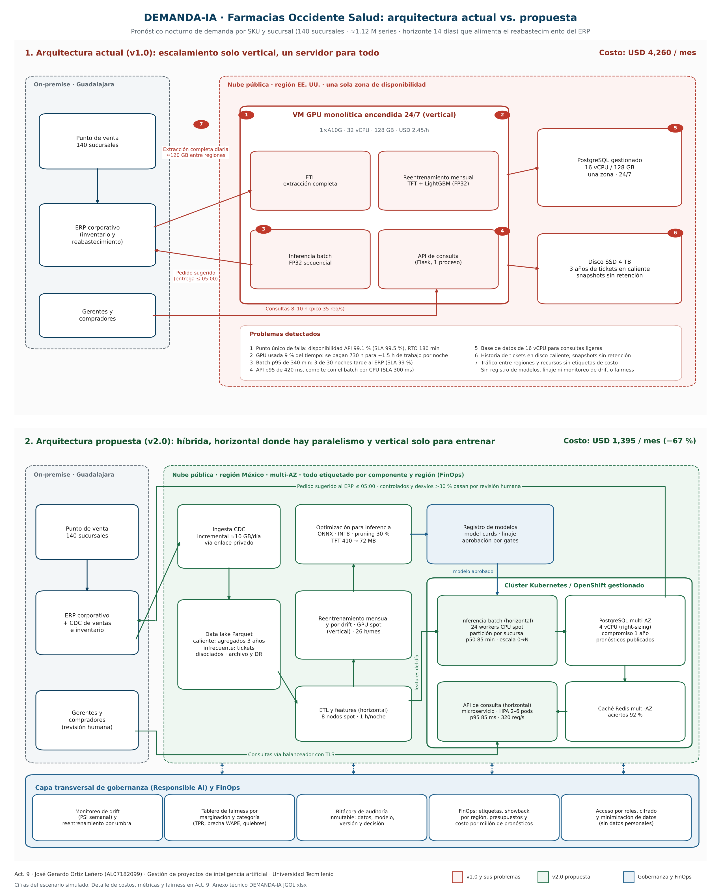

# Actividad 9 · Escalación responsable de DEMANDA-IA

**Farmacias Occidente Salud (caso simulado)** · Gestión de proyectos de inteligencia artificial · Universidad Tecmilenio
José Gerardo Ortiz Leñero (AL07182099) · Profesora: Ing. Tania Judith Mendoza Torres

DEMANDA-IA pronostica cada noche la demanda por SKU y sucursal a 14 días (140 sucursales, ≈1.12 millones de series) y entrega un pedido sugerido al ERP. Este repositorio contiene el código que acompaña al reporte técnico de la Actividad 9. Con él se reproducen las cifras del rediseño y se comprueba que el sistema solo escala si cumple al mismo tiempo con el costo, el SLA, la equidad y el cumplimiento normativo.

La estructura sigue el starter de la Actividad 8 (`config/`, `data/`, `src/`, `runbooks/`, `docs/`, `outputs/`, `demo.sh`). Agregué `deployment/` (manifiestos de Kubernetes del rediseño) y `tests/` (pruebas que comparan los resultados con el anexo técnico).



---

## 1. Qué cubre este repositorio

```text
supuestos (config/)
   ↓
datos simulados: backtest por sucursal, noches de batch, consultas a la API
   ↓
costo v1.0 vs v2.0 (FinOps)  ─┐
capacidad vertical vs horizontal ─┤
desempeño contra el SLA        ─┼─→  gate de escalamiento  →  APROBADO / BLOQUEADO
fairness por grupo (T22)       ─┤          ↓
controles de cumplimiento      ─┘     runbook + evidencia (dashboard, MLflow, logs, trazas)
```

| Tema | Archivo | Qué demuestra |
|---|---|---|
| Escalabilidad (T21) | `src/capacity_planner.py`, `deployment/k8s/` | v1.0 solo puede crecer en vertical; v2.0 agrega workers y mantiene el batch en 85 min |
| Costos y FinOps (T21) | `src/cost_model.py` | USD 4,260.50 → 1,395.22 al mes (−67.3 %), USD 2.97 por millón de pronósticos, sensibilidad y crecimiento |
| Desempeño y SLA (T21) | `src/performance_report.py` | Latencia, throughput y uso de recursos de v1.0 y v2.0 contra el SLA |
| Fairness (T22) | `src/fairness_audit.py` | Igualdad de oportunidades, predictive parity, equalized odds y paridad demográfica entre sucursales urbanas y rurales |
| Gobernanza (T22) | `src/governance_gate.py`, `docs/MODEL_CARD.md`, `runbooks/` | El escalamiento se bloquea si falla una dimensión prioritaria |

## 2. Lo que este repositorio no hace

- No entrena el modelo de pronóstico: trabaja con los resultados del backtest y de las pruebas de carga.
- Los datos son **sintéticos** y están calibrados para reproducir el anexo técnico. No hay datos de clientes ni de pacientes.
- Las tarifas de nube son valores de referencia, no una cotización.
- Los manifiestos de Kubernetes usan imágenes ilustrativas (`registry.example.com`); muestran la configuración de escalamiento, no un despliegue listo para producción.

---

## 3. Primera vez: clonar el repositorio

### Windows / PowerShell

```powershell
cd $HOME\Documents
git clone https://github.com/gerardortizle/Act-9-Escalacion-DEMANDA-IA.git
cd .\Act-9-Escalacion-DEMANDA-IA
code .
```

### macOS / Linux

```bash
cd ~/Documents
git clone https://github.com/gerardortizle/Act-9-Escalacion-DEMANDA-IA.git
cd Act-9-Escalacion-DEMANDA-IA
code .
```

## 4. Crear el entorno virtual

### Windows

```powershell
python -m venv .venv
Set-ExecutionPolicy -Scope Process -ExecutionPolicy Bypass
.\.venv\Scripts\Activate.ps1
python -m pip install --upgrade pip
python -m pip install -r requirements.txt
```

### macOS / Linux

```bash
python3 -m venv .venv
source .venv/bin/activate
python -m pip install --upgrade pip
python -m pip install -r requirements.txt
```

---

## 5. Ejecutar la demostración base

### Paso 1. Generar los datos simulados

```bash
python data/generate_demo_data.py
```

Crea `data/backtest.csv` (218,400 filas), `data/batch_nights.csv` y `data/api_requests.csv`.

### Paso 2. Correr el pipeline completo

```bash
python src/run_pipeline.py --scenario base --phase full_rollout
```

Salida esperada (resumen):

```text
Costo: USD 4,260.50 → 1,395.22 al mes (ahorro 67.3 %), USD 2.97 por millón de pronósticos
SLA v2.0: cumple | batch p50 85.0 min | API p95 85.0 ms
Fairness (modelo v2): brecha WAPE 4.6 pp | TPR C/A 0.931 | quiebre esenciales C/A 1.45
Capacidad: 24 workers para 140 sucursales
GATE: APROBADO
```

Cada etapa también se puede correr por separado:

```bash
python src/cost_model.py
python src/capacity_planner.py --branches 140 180 220 280
python src/performance_report.py
python src/fairness_audit.py
python src/governance_gate.py --phase pilot
python src/dashboard.py
```

### Archivos que se generan en `outputs/`

| Archivo | Contenido |
|---|---|
| `cost_report.json`, `cost_lines.csv` | Costo por recurso y categoría, costo unitario, ahorro anual y proyección de crecimiento |
| `capacity_plan.json` | Workers necesarios y si el batch cabe en la ventana 23:00–05:00 |
| `performance_report.json` | Latencia, throughput y uso de recursos contra el SLA |
| `fairness_report.json` | Métricas por grupo de marginación e indicadores C frente a A |
| `gate_decision.json` | Decisión del gate y checks que fallaron |
| `dashboard.png` | Tablero de costo, SLA, fairness y crecimiento |
| `pipeline_log.jsonl`, `traces.jsonl` | Log y trazas por etapa de cada corrida |

---

## 6. Escenarios

| Escenario | Qué simula | Resultado del gate |
|---|---|---|
| `base` | Rediseño v2.0 con los supuestos del anexo | APROBADO |
| `spot_conservador` | 50 % de horas spot a bajo demanda, sin compromiso, batch de 2.5 h | BLOQUEADO por costo unitario (USD 4.22 por millón); el ahorro sigue en 53.4 % |
| `spot_pesimista` | Sin spot y sin compromiso, batch de 3 h | BLOQUEADO: ahorro de 43.8 % < 50 % |
| `crecimiento_180` | La cadena crece a 180 sucursales | APROBADO con 31 workers y USD 1,453 al mes |
| `sesgo_sin_mitigacion` | Infraestructura v2.0 con el modelo v1.0 (sin mitigaciones de sesgo) | BLOQUEADO por 5 indicadores de fairness |
| `cache_caido` | Redis no responde y todas las consultas llegan al modelo | BLOQUEADO por tasa de aciertos de caché |

```bash
python src/run_pipeline.py --scenario sesgo_sin_mitigacion
python src/simulate_scenarios.py          # corre todos y guarda outputs/scenario_comparison.csv
```

Cada escenario bloqueado tiene su runbook:

| Escenario | Runbook |
|---|---|
| `spot_conservador`, `spot_pesimista` | `runbooks/RUNBOOK_COSTO_SPOT.md` |
| `sesgo_sin_mitigacion` | `runbooks/RUNBOOK_FAIRNESS.md` |
| `cache_caido` | `runbooks/RUNBOOK_SLA_BATCH_API.md` |

---

## 7. Gate de escalamiento (governance-as-code)

`src/governance_gate.py` revisa cuatro dimensiones antes de dejar avanzar una fase del plan:

1. **SLA**: todas las métricas de `config/sla_config.json` en verde.
2. **Costo**: costo por millón de pronósticos bajo la meta (USD 3.50 en el piloto, 3.25 en operación) y, para el despliegue total, ahorro ≥ 50 % frente a v1.0.
3. **Fairness**: indicadores de prioridad "prioritaria" y "alta" de `config/governance_config.json`. La razón de FPR está registrada como riesgo residual aceptado por el comité.
4. **Cumplimiento**: model card, registro de modelos, bitácora inmutable y exclusión de controlados del autopedido.

El script devuelve código de salida 1 si el gate no pasa, así que se puede usar como paso de un pipeline de CI/CD.

```bash
python src/governance_gate.py --scenario base --phase pilot
python src/governance_gate.py --scenario spot_pesimista --phase full_rollout   # sale con código 1
```

---

## 8. MLflow

Cada corrida de `run_pipeline.py` registra parámetros, métricas y artefactos en el experimento `Act9_Escalacion_DEMANDA-IA`.

```bash
python -m mlflow ui --backend-store-uri sqlite:///mlflow.db --port 5000
```

Abre `http://localhost:5000` y compara las corridas de los distintos escenarios.

---

## 9. Despliegue en Kubernetes / OpenShift (`deployment/k8s/`)

| Manifiesto | Patrón de escalamiento |
|---|---|
| `batch-inference-job.yaml` | Horizontal: CronJob con Job indexado de 24 particiones en nodos spot, reintento por partición |
| `api-deployment.yaml` | Horizontal: Deployment con HPA de 2 a 6 pods repartidos en dos zonas y PodDisruptionBudget |
| `training-job.yaml` | Vertical acotado: un nodo GPU spot solo durante el reentrenamiento, con checkpoints y las mitigaciones R01 y R04 |

Todos los recursos llevan las etiquetas FinOps `component`, `environment`, `cost-center` y `owner`.

---

## 10. Pruebas

```bash
python -m pytest -q tests
```

`tests/test_consistency.py` comprueba que el código reproduce el anexo técnico: costos, sensibilidad, crecimiento, SLA, indicadores de fairness y la decisión del gate en cada escenario.

---

## 11. Relación con los entregables de la Actividad 9

| Entregable | Archivo |
|---|---|
| Reporte técnico | `Act. 9. Documento técnico escalación de la solución de DEMANDA-IA JGOL.pdf` |
| Anexo técnico | `Act. 9. Anexo técnico DEMANDA-IA JGOL.xlsx` |
| Diagrama de arquitectura | `Act. 9. Diagrama Arquitectura DEMANDA-IA JGOL.pdf` (copia en `docs/img/`) |
| Código | Este repositorio |

La correspondencia con cada criterio de la rúbrica está en `docs/GUIA_RUBRICA_ACT9.md`.

---

## 12. Atajos de ejecución

### Windows

```powershell
.\demo.ps1 data
.\demo.ps1 pipeline
.\demo.ps1 bias
.\demo.ps1 scenarios
.\demo.ps1 test
.\demo.ps1 ui
```

### macOS / Linux

```bash
bash demo.sh data
bash demo.sh pipeline
bash demo.sh bias
bash demo.sh scenarios
bash demo.sh test
bash demo.sh ui
```

Otras opciones: `pilot`, `costs`, `capacity`, `performance`, `fairness`, `spot`, `growth`, `cache`, `dashboard`.

## 13. Estructura

```text
Act-9-Escalacion-DEMANDA-IA/
├── README.md
├── requirements.txt
├── demo.sh / demo.ps1
├── config/
│   ├── scaling_config.json       # supuestos de operación, tarifas y palancas FinOps
│   ├── sla_config.json           # objetivos del SLA
│   ├── governance_config.json    # grupos, umbrales de fairness y gates
│   └── examples/README.md
├── data/
│   └── generate_demo_data.py
├── src/
│   ├── common.py                 # rutas, escenarios, logs y trazas
│   ├── cost_model.py
│   ├── capacity_planner.py
│   ├── performance_report.py
│   ├── fairness_audit.py
│   ├── governance_gate.py
│   ├── dashboard.py
│   ├── run_pipeline.py
│   ├── simulate_scenarios.py
│   └── project_adapter_template.py
├── deployment/k8s/
├── runbooks/
├── docs/
│   ├── GUIA_RUBRICA_ACT9.md
│   ├── MODEL_CARD.md
│   └── img/diagrama_arquitectura.png
├── tests/test_consistency.py
└── outputs/README.md
```
